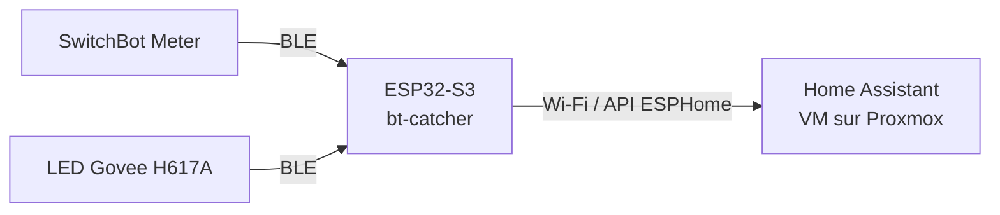

```
[.....                                       [..                               
[..   [..                                    [..   [.                          
[..    [..   [..    [... [.. [..    [..    [.[. [.     [..   [..  [..   [..    
[..    [.. [..  [..  [..  [.  [.. [..  [..   [..  [..[.  [.. [..  [.. [.   [.. 
[..    [..[..    [.. [..  [.  [..[..    [..  [..  [..[.  [.. [..  [..[..... [..
[..   [..  [..  [..  [..  [.  [.. [..  [..   [..  [.. [..[.. [..  [..[.        
[.....       [..    [...  [.  [..   [..       [.. [..    [..   [..[..  [....   
                                                         [...                  
```


# 🏠 Domotique

Ma domotique perso, chez moi, avec **Home Assistant** sur mon serveur **Proxmox**.
Objectif : tout faire en local, avec du matériel pas cher.

## ✅ Ce qui marche

| Fonction | Matériel | Comment |
|---|---|---|
| Thermomètre / hygromètre | SwitchBot Meter | Bluetooth → proxy ESP32-S3 → Home Assistant |
| LED | Govee H617A | Bluetooth → proxy ESP32-S3 → intégration *Govee LED BLE* |

## 🧱 Architecture



Les appareils parlent en Bluetooth. L'ESP32-S3 (`bt-catcher`, sous ESPHome) sert de **proxy Bluetooth** : il relaie tout vers Home Assistant en Wi-Fi.

## 🔧 Matériel

- Serveur Proxmox (Lenovo) avec une VM **Home Assistant OS**
- ESP32-S3 (proxy Bluetooth)
- Thermomètre SwitchBot Meter
- Ruban LED Govee H617A

## 🚀 Installation

### 1. Proxy Bluetooth (ESPHome)

Fichier [`esphome/bt-catcher.yaml`](esphome/bt-catcher.yaml) :

```yaml
esphome:
  name: bt-catcher

esp32:
  board: esp32-s3-devkitc-1
  framework:
    type: esp-idf

wifi:
  ssid: !secret wifi_ssid
  password: !secret wifi_password

api:
  encryption:
    key: !secret api_key

ota:
  - platform: esphome

logger:

esp32_ble_tracker:
  scan_parameters:
    active: true

bluetooth_proxy:
  active: true
```

Les identifiants sont dans `secrets.yaml` (**non versionné**).

### 2. Home Assistant

1. *Paramètres → Appareils* : ajouter l'appareil ESPHome `bt-catcher`.
2. Le **SwitchBot Meter** est détecté automatiquement (intégration SwitchBot Bluetooth).
3. Les **LED Govee** : installer l'intégration *Govee LED BLE*, puis les ajouter.

## 🗺️ Prochaines étapes

- [ ] Automatiser les lumières
- [ ] Réveil Android → allume les LED quand je suis réveillé
- [ ] Assistant vocal (Waveshare ESP32-S3-Touch-LCD-1.54)
- [ ] Panneau domotique
- [ ] Caméra : photo si quelqu'un entre quand je ne suis pas là
